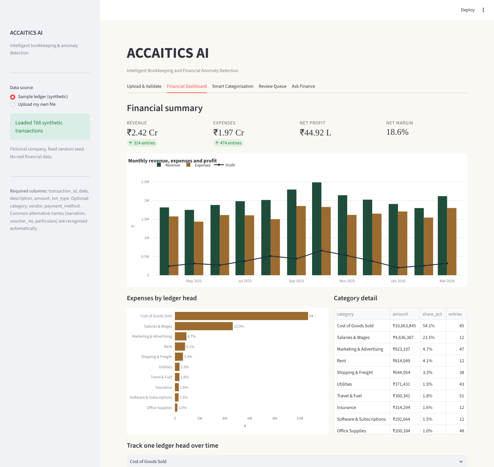
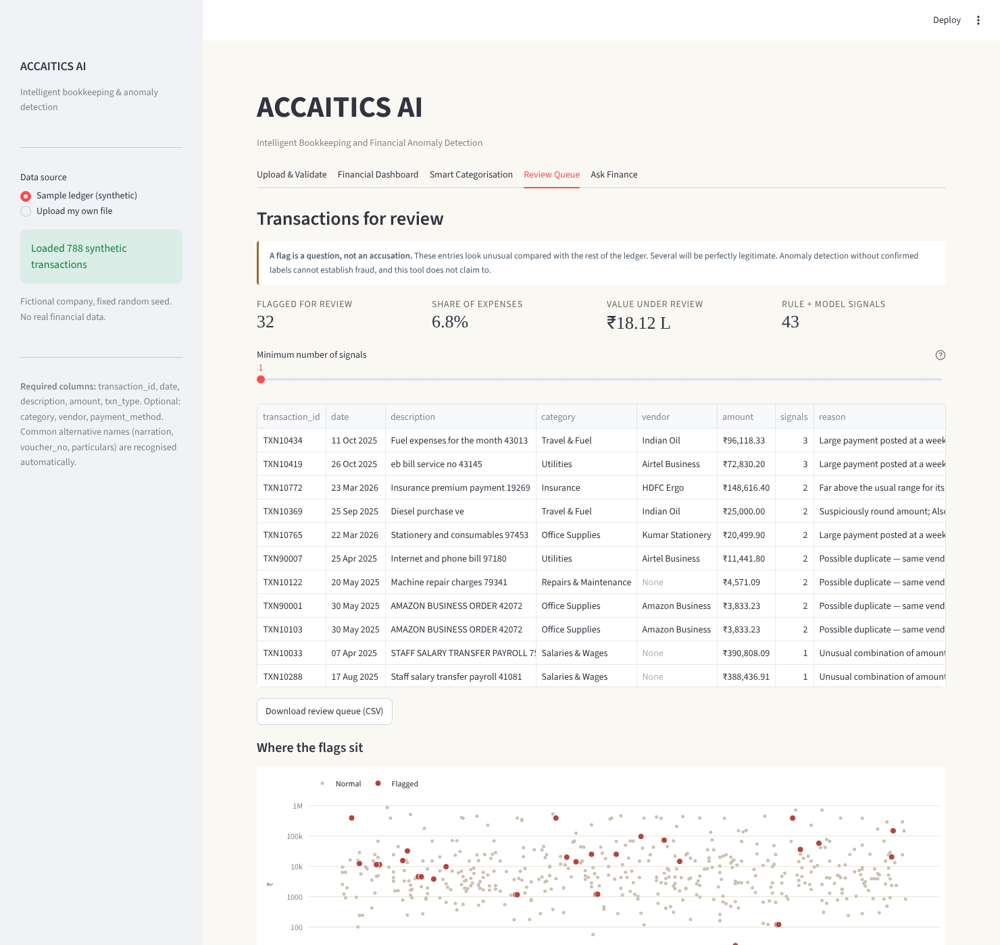

# ACCAITICS AI

**An Intelligent Bookkeeping and Financial Anomaly Detection System**

A working Streamlit application that reads an accounting ledger, suggests ledger
categories from transaction descriptions, flags unusual entries for an
accountant to review, calculates financial KPIs, and answers plain-English
questions about the data.

Built to combine accounting knowledge (B.Com, Tally, QuickBooks, Excel, Power BI,
SQL) with practical machine learning.





```bash
pip install -r requirements.txt
python run_all.py          # generate data, train, evaluate, test — ~20 seconds
streamlit run app.py       # launch the application
```

---

## What it does

| Feature | How it works |
|---|---|
| **Upload & validate** | Checks required columns, parses messy dates and currency strings, reports unreadable rows and duplicate voucher numbers instead of silently dropping them |
| **Smart categorisation** | TF-IDF on character n-grams + logistic regression, benchmarked against a keyword rule baseline, with confidence-based routing to a human |
| **Anomaly detection** | Business rules for definable errors + Isolation Forest for the rest, trained without labels |
| **Financial analytics** | Revenue, expenses, profit, margin, category breakdown and monthly trends — all deterministic arithmetic |
| **Ask Finance** | Plain-English questions matched to a calculation that runs on the ledger; every answer shows its own arithmetic |

---

## Measured results

Every number below is what the code actually produced on the synthetic ledger.
Run `python run_all.py` to reproduce them.

### The dataset

788 transactions covering April 2025 – March 2026 for a fictional company.
314 income entries, 474 expense entries, 13 expense heads.
Revenue ₹2.42 Cr, expenses ₹1.97 Cr, net profit ₹44.92 L (18.6% margin).
30 error rows deliberately planted and recorded in a key the models never see
(23 injections; duplicates count both halves of the pair).

### Expense categorisation

Trained on 355 expense rows, tested on 119 held-out rows across 13 expense heads.

| | Accuracy | Macro-F1 |
|---|---|---|
| **Keyword rules** | 95.0% | **0.955** |
| TF-IDF + Logistic Regression | 95.0% | 0.929 |

**The rules win, and the model does not earn its place on accuracy.** That is
the honest result, and it took a bug fix to see it — details in "What went
wrong" below.

Accuracy is identical, but it hides the thing that matters. Both make 6 errors
on the same 119 rows, and the errors are completely different in kind:

- **Rules:** fire on 95% of rows and are **100% correct** where they fire. All
  6 errors are **abstentions** — the rules never put a transaction in the wrong
  ledger head.
- **Model:** 6 **confident miscodings**, four of them dumped into Cost of Goods
  Sold (`cash payment 48096`, `general expenses`, `adjustment entry 89549`…).

For a tool that posts entries unchecked, abstaining is the safer failure.
Accuracy cannot tell the two apart.

**So why keep the model?** Because I wrote those rules with the generator's
templates in front of me, which is its own form of overfitting. The decisive
test is text neither has seen — 13 descriptions phrased the way a different
bookkeeper would write them (`hsd for tempo`, `staff remuneration mar-26`,
`adwords topup`):

| | Fires on | Correct |
|---|---|---|
| Keyword rules | 46% | 6 / 13 |
| **Model** | 100% | **10 / 13** |

Rules are precise on wording you have already seen and silent on everything
else. That is the trade, and it decides the design.

**What ships: rules first, model fills the gaps.**

- Rule hits auto-post directly — deterministic, no confidence test needed
- The model handles only what the rules abstain on
- Confidence below threshold goes to a human

Threshold **0.60**, chosen by 4-fold cross-validation **inside the training
set** (CV estimate: 93.0% auto-posted at 99.7%). Applied to the held-out set:

- **95.0%** auto-posted at **100%** accuracy — **0** wrong entries reached the books
- **5.0%** routed to a human

The threshold is deliberately chosen on training data only. An earlier version
picked it on the test set and then reported accuracy on that same set, which is
marking your own exam paper.

### Anomaly detection

474 expense entries reviewed, 30 planted errors, contamination prior 6%.

| Layer | Flags | Precision | Recall | F1 |
|---|---|---|---|---|
| **Rules only** | 29 | **82.8%** | 80.0% | **0.814** |
| Isolation Forest only | 11 | 72.7% | 26.7% | 0.390 |
| Both (what ships) | 32 | 75.0% | 80.0% | 0.774 |

ROC-AUC **0.925** for the Isolation Forest score, which measures ranking quality
independently of where the cut falls.

Detection by error type:

| Error type | Caught |
|---|---|
| duplicate | 14 / 14 |
| round_number | 1 / 1 |
| fat_finger | 3 / 4 |
| outlier_amount | 5 / 7 |
| weekend_large | 1 / 4 |

**Stated plainly: on this ledger the Isolation Forest finds nothing the rules
miss.** Its 3 unique flags are all false positives — zero incremental true
positives. Rules alone beat the hybrid on precision and F1 at identical recall.

It ships anyway, and the argument is forward-looking rather than measured:
rules only catch error types somebody thought to write a rule for, and the next
error in a real ledger will be one nobody anticipated. The cost of carrying it
is 3 extra rows in the queue. That is a design judgement, not a result — and
the difference is worth being clear about.

The `round_number` rule deserves a caveat too. It tests `amount % 25000 == 0`,
and the generator plants round errors as multiples of 25,000. It fires on
exactly one row and that row is the planted error. That is closer to a lookup
of the generator's constants than a measurement, and on real books (where rent
and salary advances are routinely round) it would fire constantly.

### Test suite

**65 tests, all passing.** `python -m pytest tests/ -q`

- Reconciliation: revenue, expenses, profit and margin each computed independently
  from the raw CSV and from SQL, and asserted equal to the paisa
- Worked examples with arithmetic checkable on paper
- Validation: missing columns, bad dates, currency symbols, duplicate IDs,
  alternative column names, empty files
- ML behaviour: macro-F1 scored over a fixed label set, rules never miscode,
  the model generalises better to unseen wording, no label leaks into anomaly
  features, threshold chosen off the test set, detection is deterministic
- Assistant: nine question→intent assertions, no answer emits `nan` or `inf`,
  every answer either carries traceable workings or is an explicit refusal

Four of the bugs described below were deliberately reintroduced to confirm the
suite catches them. All four produced a failing test.

---

## Four things that went wrong

These are the parts that taught me something. The last one was caught by an
independent review after I had already written the README, which is itself the
lesson.

### 1. A date-parsing bug silently corrupted 39% of the ledger

The validator used `pd.to_datetime(..., format="mixed", dayfirst=True)`,
reasoning that Indian exports usually write DD/MM/YYYY. That silently
reinterpreted ISO dates: **2025-04-01 became 4 January 2025**. 305 of 788 rows
were corrupted. Every date still looked valid, nothing raised an error, and the
monthly reports were simply wrong — revenue appeared to run from January 2025
to December 2026 in a ledger covering April 2025 to March 2026.

I caught it because a trend answer said revenue had fallen 59.8% between two
months that should not have existed.

The fix resolves the unambiguous format first: try ISO, then fall back to
day-first for whatever is left. There is a named regression test
(`test_iso_dates_are_not_mangled_by_dayfirst`) and a second asserting the whole
ledger stays inside its financial year.

**The lesson:** a bug that raises an error is cheap. A bug that produces
plausible wrong numbers is expensive, and financial code is full of them.

### 2. The anomaly detector flagged ₹15 entries

The first version ran Isolation Forest on raw features and filled the review
queue with the *smallest* transactions in the ledger — ₹15.69, ₹24.82. Recall
was 30%, precision 37%.

Two causes. Isolation Forest is two-sided: a very small amount is as "isolated"
as a very large one. And expense amounts are heavily right-skewed, so a global
average is meaningless when a materials bill is naturally 100× a stationery bill.

The fixes: compare each amount against **its own ledger head**, on a **log
scale**, with **robust statistics** (median and MAD, so a few large errors
cannot inflate the yardstick they are measured against), and make it
**one-sided** — only unusually large amounts are flagged.

Recall went from 30% to 80%.

### 3. A metric bug reversed the project's headline claim

This is the one worth reading.

The README used to say the ML model beat the keyword rules on macro-F1, 0.929
against 0.887. It does not. Both `f1_score` calls omitted `labels=`, and
sklearn then averages over the **union** of labels in `y_true` and `y_pred`.
The rule baseline emits `"Uncategorised"` when it abstains — a phantom 14th
class scoring 0.0 — so the baseline was divided by 14 while the model was
divided by 13.

Scored over the same 13 real ledger heads: **rules 0.955, model 0.929**. The
rules win.

Worse, the original conclusion was defended with two statistics I had not
checked: that the rules "fall over on Insurance (9 rows)" while handling "Cost
of Goods Sold (45 test rows)". Insurance has **3** rows in the test set, COGS
has **11**, and measured per-category F1 shows the rules *tie* the model on
Insurance (0.800 each) and *beat* it on COGS (1.000 vs 0.846). The supporting
numbers were as wrong as the claim.

The corrected story is better than the one it replaced: the rules never
miscode, they only abstain; the model generalises to wording the rules have
never seen; so the right design is rules first and model in the gaps. That is
now what ships.

**The lesson:** a metric with a default you did not choose is not a measurement.
And a claim is not safer for having supporting numbers attached — those need
checking too.

### 4. The evaluation harness was scoring correct findings as failures

`inject_anomalies` recorded only the injected copy of each duplicate pair in
the answer key. The duplicate rule flags **both** halves — it cannot know which
is the original — so every correct catch scored as one true positive and one
false positive.

Seven of the fifteen reported false positives were not errors at all. Fixing
the key to record both IDs moved hybrid precision from 53.1% to **75.0%** and
rules-only precision to **82.8%**, with no change to the detector.

**The lesson:** when a metric looks disappointing, check the measuring
instrument before changing the thing being measured.

## Honest limitations

A portfolio project that only reports wins is not credible. These are real:

- **The anomaly figures do not establish fraud detection.** They measure how well
  the detector finds errors *I planted myself*. Real errors are not drawn from the
  same distribution, and real fraud is designed to look normal. Every flag is a
  question for a human, not a conclusion.
- **The test sets are small.** 119 rows for categorisation, 30 planted errors
  for detection, 13 descriptions in the generalisation probe. A single
  misclassification moves auto-post accuracy by nearly a point. Every threshold
  here needs re-validating on more data before anyone relies on it.
- **Isolation Forest currently detects nothing the rules miss.** Its value in
  this project is a design argument about unanticipated error types, not a
  measured result. Say so rather than implying otherwise.
- **The keyword rules were written with the generator in front of me.** They are
  fitted to text I had already seen, which is why they look so strong on the
  held-out set and drop to 46% coverage on unfamiliar wording.
- **Weekend-large detection is weak** — 1 of 4 caught. Those errors multiply a
  below-median amount, so they land close to the category median and no
  amount-based test separates them.
- **Categorisation reads text only.** Vendor name is a stronger signal in
  practice: `paid to party 36909` is unresolvable from text but trivial if you
  know the payee. Adding vendor as a feature is the obvious next step.
- **The assistant's intent layer is keyword-based,** so it is brittle on phrasings
  it has not seen. A real LLM would slot into that layer without touching the
  calculation layer.
- **Synthetic data is kinder than reality.** Real ledgers have inconsistent
  chart-of-accounts mappings, mid-year restructures and messier edge cases.
  Expect every score here to drop on real books.
- **No authentication, database persistence or multi-user support.** It is a
  single-user analysis tool, not a SaaS product.

---

## The architecture decision that matters most

**A language model must never produce a financial figure.**

Ask an LLM what your March expenses were and it will return a confident,
plausible, entirely invented number. In marketing that is annoying. In accounting
somebody files a return on it.

So Ask Finance is built as:

```
question
   → intent matching           (which kind of question is this?)
   → parameter extraction      (which month? which category?)
   → calculation in pandas     (the number comes from the ledger)
   → templated sentence        (language only wraps a verified result)
```

Every answer carries a `workings` string showing the arithmetic. When a question
cannot be answered from the data — "how much do customers owe me?" needs invoice
due dates a transaction list does not have — it says so rather than guessing.
**The refusal is a feature.**

`FUNCTION_SCHEMA` in `accaitics/ask.py` exposes the same eight calculations as
JSON tool definitions. Drop them into an OpenAI or Anthropic function-calling
loop and the model replaces the keyword matcher while the calculation layer stays
exactly as it is. The trustworthy part does not change.

---

## Project layout

```
accaitics-ai/
├── app.py                      # Streamlit application (5 tabs)
├── run_all.py                  # regenerate, train, evaluate, test
├── requirements.txt
├── accaitics/
│   ├── generate.py             # synthetic ledger + planted errors
│   ├── accounting.py           # validation + verified calculations
│   ├── categorise.py           # rules vs ML, confidence routing
│   ├── anomaly.py              # rules + Isolation Forest
│   └── ask.py                  # Q&A over calculations
├── tests/
│   ├── test_accounting.py      # 22 tests — reconciliation and validation
│   └── test_ml.py              # 43 tests — model behaviour, intents, refusals
├── sql/queries.sql             # 10 validated SQL queries
├── data/
│   ├── transactions.csv        # the ledger
│   ├── anomaly_key.csv         # answer key — models never read this
│   └── accaitics.db            # SQLite copy
└── outputs/                    # metrics JSON, review queue, error analysis
```

Each module runs standalone and prints its own reasoning:

```bash
python -m accaitics.generate      # build the data
python -m accaitics.categorise    # train and compare against rules
python -m accaitics.anomaly       # detect and evaluate
python -m accaitics.ask           # Q&A demonstration
```

---

## Technology

| Tool | Used for |
|---|---|
| Python 3.10+ | Application logic |
| pandas | Cleaning and analysing transaction data |
| scikit-learn | TF-IDF, logistic regression, Isolation Forest |
| SQLite | Storing and querying the ledger |
| Streamlit | The interactive application |
| Plotly | Charts |
| pytest | 49 tests |

No API keys, no paid services, no internet access required.

---

## Data and privacy

All data is **synthetic**, generated by `accaitics/generate.py` with a fixed seed
for a fictional company. **No real client books are used anywhere.**

That is a deliberate professional habit rather than a convenience: real client
ledgers should never be pushed to a public repository or fed to public AI tools.
Synthetic data lets the method be published without the data.

Files uploaded through the app are processed in memory and are not written to
disk or transmitted anywhere.

---

**On review.** The results above were audited by a reviewer who had not seen
the code being written. That audit found the metric bug (#3) and the evaluation
flaw (#4), both of which had already been written up as results. Getting a
second pair of eyes on your own numbers is not optional.

---

**Disclaimer.** This tool provides informational assistance only. It is not
certified accounting, tax, investment or legal advice, and no accuracy guarantee
is given. Flagged transactions are items for human review, not confirmed errors
or evidence of fraud. Verify important accounting decisions with a qualified
professional.
